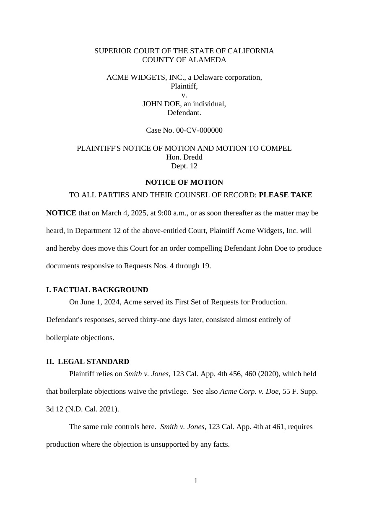

# legaldoc

Reliable MS Word output for legal documents. The model never touches layout.

`legaldoc` renders legal documents to `.docx` from a semantic intermediate
representation. Margins, spacing, fonts, emphasis, and sentence spacing come from
a specification held in data, applied by deterministic code. A linter then checks
the produced file and reports violations with exact locations.

The result is that whole classes of formatting bug cannot be expressed, and the
ones that can are caught before the document reaches a client.



Page one of a motion rendered from the IR by `demo.py`. One-inch margins,
double-spaced body, italicized case names, bold notice phrase, `PAGE` field in
the footer. No model chose any of that; `legaldoc/spec.py` did.

**Start here if you want the numbers:** [`evals/`](evals/) holds four labeled
fixtures and a six-component metric with no LLM judge. Baseline scores **0.974**;
**0.996** after GEPA. `clean_render` is **1.00 on every fixture before any
tuning**, because the model is never asked to get formatting right. Details in
[Evals](#evals); the fixtures are in
[`evals/fixtures.py`](evals/fixtures.py).

---

## Contents

- [The problem](#the-problem)
- [How it works](#how-it-works)
- [Install](#install)
- [Quickstart](#quickstart)
- [The IR](#the-ir)
- [The spec](#the-spec)
- [The renderer](#the-renderer)
- [The linter](#the-linter)
- [Typography](#typography)
- [Emphasis and case names](#emphasis-and-case-names)
- [Models](#models)
- [Evals](#evals)
- [GEPA](#gepa)
- [Extending](#extending)
- [Design notes: OOXML traps](#design-notes-ooxml-traps)
- [Known limitations](#known-limitations)
- [Repository layout](#repository-layout)
- [Development](#development)
- [Fictional content](#fictional-content)
- [License](#license)

---

## The problem

A language model driving LibreOffice produced Word documents with inconsistent
spacing, margins, and emphasis. Two specific symptoms were reported:

- told to put two spaces after every sentence, it put two spaces after every
  *period*: `Inc.  filed`, `Smith v.  Jones`, `Cal.  App.  4th`
- it bolded and underlined the same span inconsistently within one document

Neither is a language problem. Both are deterministic transformations that a
prompt cannot reliably control, because the model is being asked to make a
per-token decision that must instead be made once for the whole document.

A third symptom — inconsistent spacing and margins — has a different cause: the
model is authoring layout primitives directly. Every imperative edit is a chance
to drift. Declarative generation from a template removes that.

## How it works

```
   messy input (email, PDF text, notes, opposing counsel's doc)
        |
        v
   [ LLM: text -> semantic IR ]        legaldoc/extract.py
        |                              the only model call
        v
   [ deterministic renderer ]          legaldoc/render.py + template.py
        |                              applies spec.py, never invents layout
        v
   [ deterministic linter ]            legaldoc/lint.py
        |                              exact checks, no judge
        v
      .docx
```

The IR (`legaldoc/ir.py`) carries roles, not formatting: `heading`, `paragraph`,
`block_quote`, `caption`, `signature`, `certificate`. It has no field for
margins, spacing, fonts, or blank paragraphs. Layout is therefore not something
the model can get wrong.

Layout lives in `legaldoc/spec.py` as data. Both the renderer and the linter read
from it, so they cannot disagree about what correct means.

## Install

Python 3.11 or later.

```bash
pip install -e .              # core: renderer, linter, CLI
pip install -e '.[dspy]'      # adds the extraction step and GEPA
pip install -e '.[dev]'       # adds pytest
```

Dependencies are `python-docx`, `lxml`, and `pydantic`. `dspy` is optional and
only needed for `legaldoc/extract.py` and `evals/`.

LibreOffice is not a dependency of the library. It is useful for inspection:

```bash
soffice --headless --convert-to pdf --outdir build build/motion.docx
pdftoppm -png -r 80 build/motion.pdf build/page
```

## Quickstart

### Command line

```bash
legaldoc spec                          # print the active formatting spec
legaldoc template -o template.docx     # write the reference template
legaldoc render ir.json -o motion.docx # render an IR file, then lint the result
legaldoc lint motion.docx              # check an existing document
```

`render` lints its own output and exits non-zero if there are findings, so a
pipeline that produces a bad document fails rather than shipping it. `lint` exits
`1` when it reports anything, which makes it usable as a CI step.

`lint` accepts multiple files:

```bash
legaldoc lint *.docx
```

### Python

```python
from pathlib import Path

from legaldoc.ir import Document, Heading, Paragraph
from legaldoc.lint import lint_docx
from legaldoc.render import render
from legaldoc.spec import LITIGATION
from legaldoc.template import build_template

template = build_template(LITIGATION, Path("template.docx"))

doc = Document(
    doc_type="memo",
    blocks=[
        Heading(level=1, text="MEMORANDUM"),
        Paragraph(
            text="Plaintiff relies on Smith v. Jones, 123 Cal. App. 4th 456 (2020). "
                 "The rule applies here.",
            case_names=["Smith v. Jones"],
        ),
    ],
)

out = render(doc, LITIGATION, template, Path("memo.docx"))
assert lint_docx(out, LITIGATION) == []
```

### Reproduce the original bug

```bash
python demo.py
```

This renders a motion from the IR, then mutates the `.docx` the way a model
editing in LibreOffice does: nudges a margin, adds a direct spacing override,
inserts blank spacer paragraphs, substitutes a font on one run, applies the
naive two-space rule, italicizes one occurrence of a case name but not another,
and drops the footer field.

The clean document lints to zero findings. The mangled one reports every
mutation with its paragraph index.

## The IR

The IR is a Pydantic model in `legaldoc/ir.py`. Six block types, discriminated on
`role`:

| role | fields |
| --- | --- |
| `heading` | `level` (1 or 2), `text` |
| `paragraph` | `text`, `emphasis`, `italic`, `case_names`, `defined_terms` |
| `block_quote` | `text`, `attribution` (optional) |
| `caption` | `court`, `parties`, `title`, `document_title`, `case_number` |
| `signature` | `name`, `bar_number`, `firm`, `address`, `phone`, `email`, `represented_party` |
| `certificate` | `text` |

`Document` is `{doc_type, blocks}`.

The four annotation lists on `paragraph` are *semantic*, not formatting:

- `emphasis` — spans the document itself marks, such as `PLEASE TAKE NOTICE`
- `italic` — source-marked italics that are not case names
- `case_names` — cited judicial case names, e.g. `Smith v. Jones`
- `defined_terms` — terms the document explicitly defines

Every span must appear verbatim in its own block's `text`. The renderer raises
`UnmatchedMark` if one does not, rather than silently ignoring it. A model that
hallucinates a span produces a loud failure instead of a subtly wrong document.

## The spec

`legaldoc/spec.py` defines two dataclasses.

`StyleSpec` describes one named paragraph style, after inheritance:

| field | meaning |
| --- | --- |
| `name` | style name as it appears in the document |
| `spacing_line` | line spacing in 240ths; `480` is double-spaced |
| `space_before`, `space_after` | in DXA (1440 per inch) |
| `first_line_indent`, `left_indent` | in DXA |
| `alignment` | `left`, `center`, `right`, `justify` |
| `font` | typeface name |
| `size_half_points` | `24` is 12pt |
| `color` | `RRGGBB` |
| `bold`, `caps` | booleans |

`DocSpec` describes the document:

| field | meaning |
| --- | --- |
| `page_width`, `page_height` | DXA |
| `margin_top`, `margin_bottom`, `margin_left`, `margin_right` | DXA |
| `header_distance`, `footer_distance` | DXA |
| `require_footer_page_number` | require a `PAGE` field in a footer |
| `require_line_numbering` | pleading paper; continuous line numbers |
| `sentence_spaces` | `1` or `2` |
| `case_name_style` | `italic` (Bluebook) or `underline` |
| `styles` | mapping of style name to `StyleSpec` |

One format ships today, `LITIGATION`: US Letter, 1" margins, Times New Roman
12pt, double-spaced body, 11pt block quotes, `PAGE` field in the footer, two
spaces after sentences, case names italicized.

Adding a format is a new `DocSpec`. Nothing else changes.

## The renderer

`legaldoc/render.py` does three things and nothing else:

1. Opens the reference template, which holds every style definition.
2. Emits one paragraph per block, setting only a style name and text.
3. Applies emphasis by interval arithmetic.

Emphasis is computed per character: each declared span contributes its format
kinds to a set, overlapping spans union their sets, and adjacent characters with
identical sets coalesce into runs. Nested and overlapping spans therefore work,
and the model never decides whether a case name is italic or underlined — the
spec does, once.

Sentence spacing is applied to block text before runs are emitted, so the model's
single spaces are normalized to the spec.

`legaldoc/template.py` builds the reference template from a `DocSpec`. It sets
`docDefaults` explicitly, because python-docx's stock template defaults to
Calibri 11 with 1.08 line spacing, and any style that does not override those
would inherit them.

## The linter

`legaldoc/lint.py` reports findings with no model in the loop. Twenty codes in
three groups.

### Direct formatting

The root cause of drift. A document should carry layout on styles, not on
paragraphs or runs.

| code | meaning |
| --- | --- |
| `direct-spacing` | paragraph carries its own `<w:spacing/>` instead of using a style |
| `direct-indent` | paragraph carries its own `<w:ind/>` |
| `direct-align` | paragraph carries its own `<w:jc/>` |
| `direct-run-format` | a run carries its own font or size |
| `spacer-paragraph` | empty paragraph used as vertical spacing |
| `unknown-style` | paragraph style is not in the spec |

### Effective formatting

After resolving the style inheritance chain down to `docDefaults`, does the
paragraph come out at the spec?

| code | meaning |
| --- | --- |
| `margins` | a section margin differs from the spec |
| `page-size` | page dimensions differ from the spec |
| `no-section` | document has no `sectPr` |
| `effective-spacing` | line spacing resolves to the wrong multiple |
| `effective-font` | font resolves to the wrong typeface |
| `effective-size` | font size resolves to the wrong size |
| `effective-color` | color resolves to the wrong value, including via a theme color |
| `theme-font` | a style sets a theme font, which overrides its explicit font name |
| `footer-page-number` | no `PAGE` field in any footer |
| `line-numbering` | pleading paper required, none present |
| `heading-order` | heading levels skip |

### Text and emphasis

| code | meaning |
| --- | --- |
| `sentence-spacing` | a real sentence end has one space, spec wants two |
| `sentence-spacing-false` | two spaces after a period that does not end a sentence |
| `emphasis-inconsistent` | the same named span is formatted two ways within one style |

`sentence-spacing` and `sentence-spacing-false` are complementary. Together they
catch the reported bug in both directions: missing spaces where sentences end,
and spurious spaces after abbreviations.

`emphasis-inconsistent` needs no answer key. It collects every run whose text
looks like a name or citation (at least eight characters, containing a space, a
period, or a comma), computes each run's *effective* bold/italic/underline, and
flags any text that appears with more than one formatting signature within the
same style. That is precisely the "bolded here, plain there" failure.

`Finding` is `(code, message, location)` and prints as:

```
[margins] left margin is 1.25in, spec is 1.00in
[sentence-spacing-false] two spaces after a period that is not a sentence end: ...Smith v.  Jones, 123 Cal.... @ para 19 (Body Text)
```

## Typography

`legaldoc/typography.py` handles sentence spacing.

A model told to "put two spaces after every sentence" applies the rule after
every period. Legal prose is dense with periods that do not end sentences:
`Inc.`, `v.`, `No.`, `Id.`, `cf.`, `e.g.`, `U.S.C.`, `Cal. App.`, `F. Supp.`,
`subd.`, `Hon.`, `Dept.`, initials in `J.Q. Attorney`, and decimals in statute
numbers.

The module is an abbreviation-aware tokenizer. It decides whether a given period
ends a sentence using, in order:

1. a lowercase following word means the clause continues (`Inc. filed`,
   `briefs... and then`)
2. an ellipsis ends a sentence
3. the preceding token is in the abbreviation set
4. the preceding token is an acronym of the form `U.S.` or `i.e.`
5. the preceding token is a single initial (`R.`)
6. a period after a closing bracket or quote ends a sentence (`(2020).`)

Result:

```
naive:   Smith v.  Jones, 123 Cal.  App.  4th 456, 460 (2020), which held...
correct: Smith v. Jones, 123 Cal. App. 4th 456, 460 (2020), which held...
```

`apply_sentence_spacing` is idempotent, and `sentence_boundaries` is exposed for
tests. The model never emits two spaces; the renderer applies them.

If the house style is one space, set `sentence_spaces = 1` and the renderer
collapses doubles. The linter checks whichever the spec says.

## Emphasis and case names

Whether a cited case is italicized or underlined is a house-style decision, not a
per-paragraph judgment. It is `DocSpec.case_name_style`, and the renderer applies
it uniformly.

The model's job is narrower: identify *which* spans are cited case names. That is
a genuine language task, and it is the only emphasis decision left to the model.

Everything else is fixed:

- `emphasis` spans are bold
- `italic` spans are italic
- `defined_terms` are bold
- case names follow `case_name_style`

A declared span that does not exist raises `UnmatchedMark` at render time.

## Models

The library has no model dependency. Rendering and linting are pure Python;
there is no model in the formatting path at all. Only `legaldoc/extract.py` and
`evals/` call one.

Tested against:

| role | model ID | settings |
| --- | --- | --- |
| extraction (`Extractor`) | `qwen38-flash-next-nvfp4` | `max_tokens=8000`, `temperature=0.0` |
| GEPA reflection | `qwen3.8-max` | `max_tokens=16000`, `temperature=1.0` |

Endpoint is `https://api.shisa.ai/v1`, which is OpenAI-compatible, authenticated
with `SHISA_API_KEY`. `evals/run.py:configure()` is the only place this is set;
point it at any OpenAI-compatible endpoint to use a different provider.

Two notes on the extraction model:

- `qwen38-flash-next-nvfp4` is a reasoning model. Responses carry a reasoning
trace alongside the content, so `max_tokens` has to cover both. At 8000 the
fixtures complete without truncation; a longer document needs more.
- `temperature=0.0` makes the baseline reproducible. The reflection model runs
hotter because GEPA needs candidate diversity.

No model was used to produce, check, or approve any formatting decision. Every
format assertion in this repository is code.

## Evals

`evals/fixtures.py` holds four labeled examples. They are synthetic, and they
cover the input shapes a practice actually sees:

| # | constant | doc type | input shape |
| --- | --- | --- | --- |
| 0 | `MOTION_SOURCE` | motion | clean prose |
| 1 | `LETTER_SOURCE` | letter | clean prose, salutation and closing |
| 2 | `MEMO_SOURCE` | memo | clean prose with headings and a block quote |
| 3 | `MESSY_SOURCE` | motion | PDF extraction: pleading line numbers, page headers, page breaks |

```bash
python -m evals.run       # baseline scores, per component
python -m evals.gepa      # optimize the extraction prompt
```

`evals/metric.py` scores six components. None is an LLM judge, deliberately: a
judge would let the optimizer target another model's opinion instead of correct
documents.

| component | weight | check |
| --- | --- | --- |
| `valid` | 0.15 | JSON parses and satisfies the IR schema (exact) |
| `grounded` | 0.15 | every declared span appears in its own block's text (exact) |
| `roles` | 0.15 | block-role sequence similarity to gold |
| `text` | 0.15 | verbatim text fidelity to gold |
| `cases` | 0.15 | F1 of cited case names |
| `clean_render` | 0.25 | renders, and the resulting `.docx` lints with zero findings (exact) |

`clean_render` carries the most weight because it is the one that ties the prompt
to the actual complaint. A model that invents a span, emits double spaces, or
adds a blank paragraph cannot score on it.

Gold scores 1.000 against itself, so the ceiling is reachable. A hallucinated
span costs about 0.3 and produces specific feedback.

### Baseline

`qwen38-flash-next-nvfp4`, `temperature=0.0`, mean **0.974**:

| # | fixture | score | valid | grounded | roles | text | cases | clean_render |
| --- | --- | --- | --- | --- | --- | --- | --- | --- |
| 0 | motion | 1.000 | 1.00 | 1.00 | 1.00 | 1.00 | 1.00 | 1.00 |
| 1 | letter | 0.979 | 1.00 | 1.00 | 0.86 | 1.00 | 1.00 | 1.00 |
| 2 | memo | 1.000 | 1.00 | 1.00 | 1.00 | 1.00 | 1.00 | 1.00 |
| 3 | motion (PDF) | 0.918 | 1.00 | 1.00 | 0.67 | 0.79 | 1.00 | 1.00 |

Two observations worth more than the mean:

- **`clean_render` is 1.00 everywhere, including on the baseline.** Even the
untuned prompt produces documents that pass the format linter. That is the
architecture working: the model was never asked to get formatting right.
- **All the lost points are role classification and text fidelity on messy
input**, not formatting. Fixture 3 lost 0.21 on `text` because it kept the
pleading line numbers inside paragraph text, and 0.33 on `roles` because it
invented a `caption` block. Both are genuine language errors, which is exactly
what an optimizer should be pointed at.

### After GEPA

Mean **0.996**, same four examples:

| # | fixture | score | valid | grounded | roles | text | cases | clean_render |
| --- | --- | --- | --- | --- | --- | --- | --- | --- |
| 0 | motion | 1.000 | 1.00 | 1.00 | 1.00 | 1.00 | 1.00 | 1.00 |
| 1 | letter | 1.000 | 1.00 | 1.00 | 1.00 | 1.00 | 1.00 | 1.00 |
| 2 | memo | 1.000 | 1.00 | 1.00 | 1.00 | 1.00 | 1.00 | 1.00 |
| 3 | motion (PDF) | 0.983 | 1.00 | 1.00 | 0.89 | 1.00 | 1.00 | 1.00 |

The remaining 0.017 on fixture 3 is role classification: the model still prefers
its own block boundaries over the gold ones. Arguably the gold is too strict
there, since the source does contain a caption.

## GEPA

`evals/gepa.py` optimizes exactly one thing: the instruction text of
`ExtractIR`. It cannot affect margins, spacing, fonts, or emphasis, because those
are not in the prompt. That is the design, not a limitation of the optimizer.

```bash
python -m evals.gepa
```

Results are in [Evals](#evals). **They are in-sample.** `evals/gepa.py` uses the
same four examples for training and validation, so 0.996 is not a generalization
estimate. The run demonstrates that the loop closes and that the feedback is
specific enough to drive useful edits. The optimized prompt picked up rules that
were not in the original, each traceable to a fixture failure:

- ignore page headers, footers, page labels, page numbers, and pleading-style
  line numbers (from fixture 3)
- do not treat `PLEASE TAKE NOTICE` as a heading; it is a paragraph (from the
  letter fixture's role error)
- do not emit caption blocks (from the model inventing one in fixture 3)

A real optimization needs 20-50 labeled documents and a held-out set. The labels
are the expensive part; the metric is cheap once they exist.

Note that the baseline was already 0.974 and already perfect on `clean_render`.
The extraction step was never the bottleneck. Formatting was, and formatting is
now exact rather than learned.

Configuration:

| environment variable | default |
| --- | --- |
| `LEGALDOC_MODEL` | `qwen38-flash-next-nvfp4` |
| `LEGALDOC_REFLECTION_MODEL` | `qwen3.8-max` |
| `LEGALDOC_GEPA_CALLS` | `40` |

Endpoint and API key are covered in [Models](#models).

## Extending

### Add a document format

Add a `DocSpec` to `spec.py` and register it in `SPECS` in `cli.py`. Then:

```bash
legaldoc --spec my-format lint doc.docx
```

### Import the firm's existing templates

This is the highest-value extension. If the firm already has Word templates
(`.dotx`), the spec should be generated from them rather than written by hand,
because those templates already encode the answer.

Approach: unzip the `.dotx`, read `word/styles.xml` and the section properties in
`word/document.xml`, and emit a `DocSpec`. `legaldoc/lint.py` already contains
the inheritance-resolution logic needed to read a style chain, so the work is
mostly serialization.

### Add a block type

1. Add a model to `ir.py` with a new `role` literal and add it to `BlockT`.
2. Add a case to `_style_for` and to `render()`.
3. Add the style to `DocSpec.styles`.

The linter needs no change; it checks styles, not block types.

### Add a lint check

Append a `Finding` in `lint_docx`. If the check needs effective formatting,
`_Styles` already resolves the inheritance chain for spacing, size, font, color,
and the `b`/`i`/`u` flags.

## Design notes: OOXML traps

Both of these were live bugs in this repository's own renderer, found by
rendering the output and looking at it. Neither is caught by schema validation.

### A theme attribute beats an explicit value

python-docx's stock Heading styles set both `w:ascii="Times New Roman"` and
`w:asciiTheme="majorHAnsi"`. Word uses the theme font, so the explicit name is
silently ignored and the document renders in the theme face. The same applies to
`w:color` with `w:themeColor`, which is why the headings rendered blue despite
the spec saying `000000`.

`template.py` strips theme attributes from `rFonts` and `w:color`. `lint.py`
reports `theme-font` and `effective-color` when they survive.

### `<w:br/>` is not `<w:t>`

python-docx stores a newline as `<w:br/>` and a tab as `<w:tab/>`. Collecting only
`<w:t>` nodes concatenates the two lines into one word and invents a sentence
boundary that was never in the document. `_para_text` flattens breaks and tabs to
spaces.

### Schema validation is not style validation

Validating OOXML against XSD tells you the file is well-formed. It says nothing
about whether the margins are right, whether paragraphs use styles, or whether
spacing was overridden. A document with 1.25" margins and direct spacing on every
paragraph passes XSD validation cleanly.

## Known limitations

- **No `.dotx` import.** Specs are written by hand. See
  [Extending](#import-the-firms-existing-templates).
- **No tables.** The IR has no table block. Legal documents need them, and tables
  are where dual-width and shading bugs live.
- **No auto-numbering.** Numbered paragraphs need `numPr` referencing the
  template's list definitions; not implemented.
- **One jurisdiction.** `LITIGATION` is a generic US trial-court format. Local
  rules vary by jurisdiction and by judge, and some require line numbering.
- **No tracked changes or redlining.** Out of scope. `w:ins`/`w:del` handling is
  a separate problem with its own failure modes.
- **No PDF round-trip check.** Converting to PDF and comparing page count and text
  bounding boxes against a golden PDF would catch layout drift that XML
  inspection misses. Not implemented.
- **Emphasis consistency is heuristic.** `_is_named_span` uses a length and
  punctuation threshold. It can miss a short case name, and it does not compare
  across paragraph styles.
- **The abbreviation set is US-legal-specific.** `typography.ABBREV` covers common
  US citation forms and California codes. Other jurisdictions need additions.
- **GEPA results are in-sample.** See [GEPA](#gepa).

## Repository layout

```
legaldoc/
  spec.py        DocSpec, StyleSpec, LITIGATION
  ir.py          block models, Document
  template.py    build the reference .docx from a DocSpec
  render.py      IR -> .docx; emphasis interval arithmetic
  lint.py        .docx -> findings; style inheritance resolution
  typography.py  sentence spacing tokenizer
  extract.py     DSPy signature and module (optional dependency)
  cli.py         lint / render / template / spec
  __main__.py    python -m legaldoc
evals/
  fixtures.py    labeled examples
  metric.py      six-component metric, no LLM judge
  run.py         baseline scores
  gepa.py        prompt optimization
tests/
  test_lint.py        format checks, defect injection
  test_typography.py  sentence spacing, exact assertions
  test_cli.py         exit codes and round-trips
docs/
  preview.png         page one of the demo motion, used in this README
demo.py          render, mangle, lint both
```

## Development

```bash
python -m pytest tests/ -q     # 55 tests, all deterministic, under a second
python demo.py                 # visual and diagnostic reproduction
```

The test suite has no network dependency and no model calls. The eval harness
does, and is run separately.

To inspect a rendered document:

```bash
soffice --headless --convert-to pdf --outdir build build/motion.docx
pdftoppm -png -r 80 build/motion.pdf build/page
```

To regenerate the preview image at the top of this README:

```bash
python demo.py
soffice --headless --convert-to pdf --outdir build build/motion.docx
pdftoppm -png -r 110 -f 1 -l 1 build/motion.pdf build/preview
magick build/preview-1.png -colorspace Gray -resize 880x docs/preview.png
```

## Fictional content

Everything in the documentation, demos, tests, and fixtures is fictional and
synthetic:

- Party names (`Acme Widgets, Inc.`, `John Doe`), firm names, attorney names,
  addresses, telephone numbers, and email addresses are invented. Telephone
  numbers use the `555-01xx` range reserved for fiction, and email addresses use
  the `example.com` domain reserved by RFC 2606.
- Bar numbers and case numbers are zeroed placeholders.
- Case citations such as `Smith v. Jones, 123 Cal. App. 4th 456 (2020)` are
  fabricated. Their volume and year pairings are deliberately inconsistent, so
  they cannot be mistaken for real authority.
- The judge in the demo caption, `Hon. Dredd`, is a joke referencing the comic
  character. No real judicial officer is depicted, and no real court is
  associated with these documents beyond appearing in the caption template.
- No client documents, matter files, or privileged material are included.

## License

Apache License 2.0. See [LICENSE](LICENSE) and [NOTICE](NOTICE).

```
Copyright 2025 The legaldoc Authors
```

Before publishing under your own name or entity, replace that line in `LICENSE`,
`NOTICE`, and `pyproject.toml` with the actual copyright holder.

No third-party source code is vendored in this repository. Runtime dependencies
are installed separately and carry their own licenses.

### On the Anthropic `docx` skill

That skill is proprietary. Its license forbids retaining copies outside
Anthropic's services, creating derivative works, and redistribution. It is not
vendored here and nothing in this repository is derived from it.

If you need the redlining and comment machinery that skill provides, use it
through Anthropic's own distribution rather than copying files out of it.
